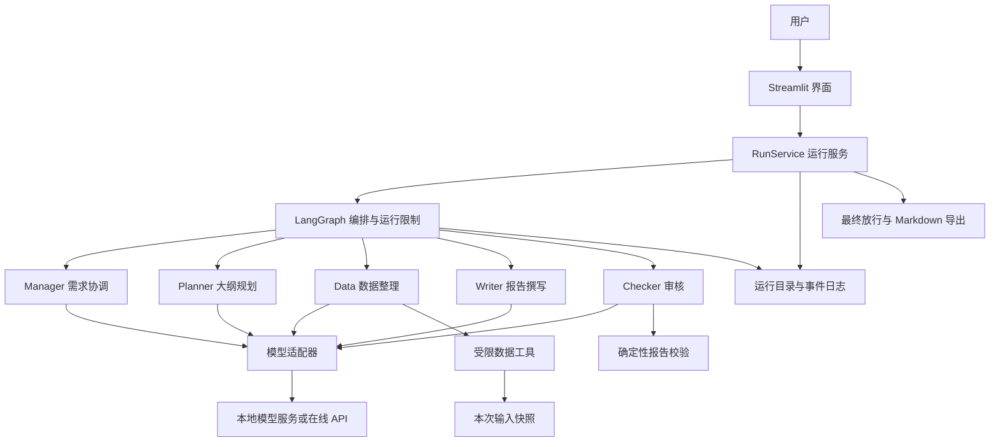
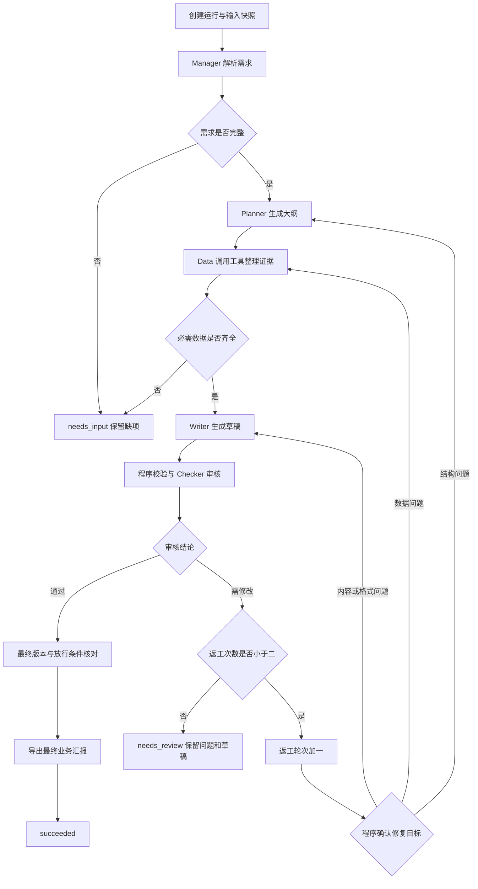
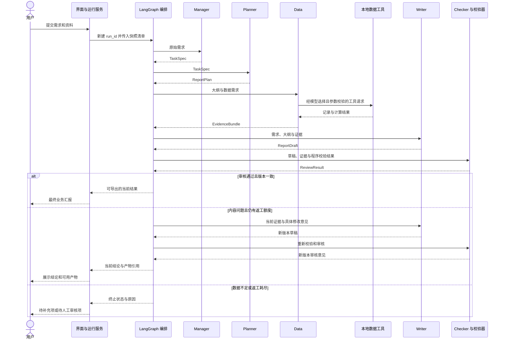

# 多智能体智能办公汇报系统架构设计

版本 0.1　日期 2026年10月28日

系统采用分层的单进程架构，由 LangGraph 控制五个 Agent 的协作流程。Agent 负责需求理解、规划、工具选择、写作和审核；编排层负责状态、路由、限额和最终放行。本设计供后续实现使用，图示和示例均不代表已经运行。

## 1 技术选型

| 组件 | 选择 | 本项目用途与依据 |
| --- | --- | --- |
| 运行语言 | Python 3.11 | 统一开发环境目标；实际兼容性在安装时验证 |
| 协作编排 | LangGraph | 用状态图表达角色交接和审核回路；支持混合确定性步骤与模型决策。[官方说明](https://docs.langchain.com/oss/python/langgraph/overview) |
| 演示界面 | Streamlit | Python 服务端执行任务，浏览器展示输入和结果。[架构说明](https://docs.streamlit.io/develop/concepts/architecture/architecture) |
| 结构校验 | Pydantic | 校验需求、角色输出、工具参数及审核意见 |
| 模型接入 | 统一模型适配器 | 根据实际设备选择本地服务或在线 API；保留真实服务和模型标识 |
| 数据与日志 | CSV、TXT、JSON、JSONL、Markdown | 本地快照、结构化产物、事件日志和业务报告 |
| 验证 | pytest 与人工运行记录 | 验证统计、路由和故障处理，另行保留真实模型实验 |

LangGraph 使用 [MIT 许可证](https://github.com/langchain-ai/langgraph/blob/main/LICENSE)，Streamlit 使用 [Apache 2.0 许可证](https://github.com/streamlit/streamlit/blob/develop/LICENSE)。来源核对日期为2026年10月28日。实际安装版本及模型许可证在实施时记录，不预设服务免费或模型一定能在当前设备上运行。

基于上述能力，选择 LangGraph 是为了直接控制共享状态、交接和返工分支，便于在体系结构课程中说明组件关系。基线使用开源库在本地运行，日志保存在本地文件中；云端编排和托管观测服务不作为运行前提。

## 2 分层与组件



| 层次 | 职责 | 主要约束 |
| --- | --- | --- |
| 展示层 | 输入、进度、阶段结果、审核意见和下载 | 不直接调用模型或写业务状态 |
| 运行服务层 | 创建运行、快照输入、建立执行上下文、持久化、导出 | 独占管理运行生命周期 |
| 编排层 | 节点顺序、状态合并、交接、返工、失败终止 | 全局计数和终态不能由模型决定 |
| Agent 层 | 按角色处理任务，产生结构化结果 | 只读取必要上下文、更新允许字段 |
| 模型与工具层 | 模型请求、参数校验、读取、统计、报告校验 | 工具使用白名单和固定计算口径 |
| 存储层 | 保存输入、产物、日志和摘要 | 按运行编号隔离，保留版本 |

五个 Agent 在同一个 Python 服务进程中执行，通过共享状态和显式交接消息协作。整体属于带有 Agent 节点的预定义工作流：Data 在受限工具集中自主选择操作，跨角色的执行路径由图控制。模型服务可以是独立进程或远程服务。这里的 Agent 通信是逻辑通信，不应在报告中描述为已经实现了分布式网络通信。

## 3 Agent 接口

统一逻辑入口为 `run(context, input) -> AgentResult`。`context` 提供运行编号、当前轮次、只读配置、模型适配器和允许的工具；`AgentResult` 包含经校验的角色结果、摘要和产物引用。异常使用统一错误对象，不以随意文本冒充成功结果。

| 角色 ID | 输入 | 输出类型 | 可用工具 | 可更新的业务状态 |
| --- | --- | --- | --- | --- |
| `manager` | 原始需求、输入清单 | `TaskSpec` | 无 | `request` |
| `planner` | `TaskSpec`、必要的审核问题 | `ReportPlan` | 无 | `plan` |
| `data` | 需求、大纲、输入清单、数据问题 | `EvidenceBundle` | `read_csv`、`read_text`、`compute_metrics` | `evidence` |
| `writer` | 需求、大纲、证据、写作问题 | `ReportDraft` | 无 | `draft` |
| `checker` | 需求、大纲、证据、草稿、程序校验结果 | `ReviewResult` | `validate_draft` | `review` |

各角色的指令单独存放，运行时分别构造上下文。Writer 不接收密钥或工具内部路径；Checker 需要取得证据和草稿，避免只凭写作摘要判断数据是否正确。

Data 的内部执行采用受限循环：模型提出工具请求 → 参数与权限校验 → 程序执行 → 将工具结果交还模型 → 继续选择工具或提交证据。所有请求、执行结果和最终提交均留痕。原生工具调用协议与结构化输出能力须在模型连通阶段验证，选择能完成该协议的模型。

在 Checker 调用前，编排层先执行一次确定性校验。Checker 可以进一步调用校验工具并结合语义检查形成结论。程序发现的阻断问题只能由修复后的产物消除，模型不能将其直接标为通过。

## 4 数据契约

### 4.1 共享状态

`RunState` 是单次任务的工作记忆，结构如下。示例中的类型为设计约定，实际实现须进行校验。

| 字段 | 类型与意义 | 写入方 |
| --- | --- | --- |
| `schema_version` | 固定为 `1.0` | 运行服务 |
| `run_id` | 唯一运行编号 | 运行服务 |
| `mode` | `live` 或 `mock` | 运行服务 |
| `status` | `created/running/succeeded/needs_input/needs_review/failed` | 运行服务和编排层 |
| `raw_request` | 用户原始需求 | 运行服务 |
| `input_manifest` | 文件 ID、快照路径、大小、SHA-256 | 运行服务 |
| `request` | 经校验的 `TaskSpec`，初始为空 | Manager 的校验包装层 |
| `plan` | 当前 `ReportPlan` 及产物引用 | Planner 的校验包装层 |
| `evidence` | 当前 `EvidenceBundle` 及产物引用 | Data 的校验包装层 |
| `draft` | 当前 `ReportDraft` 及产物引用 | Writer 的校验包装层 |
| `review` | 当前 `ReviewResult` 及产物引用 | Checker 的校验包装层 |
| `revision_round` | 初稿为 0，返工为 1、2 | 编排层 |
| `limits` | 超时、调用上限和返工上限，只读 | 运行服务 |
| `usage` | 调用数、工具数、耗时、可获得的 token 用量 | 模型适配器和编排层 |
| `artifact_index` | 不可变产物路径、哈希和轮次 | 运行服务 |
| `errors` | 错误码、位置、可读原因、尝试次数 | 运行服务和编排层 |

节点返回局部状态增量，经校验后合并。基线串行执行，单个字段只有表中约定的业务写入方；不允许 Agent 覆盖整个状态。数据或大纲更新后，旧草稿与审核结论立即失效，必须重写和重审。

### 4.2 业务对象

| 对象 | 核心字段 |
| --- | --- |
| `TaskSpec` | `title, department, period, required_sections, output_format, input_file_ids, missing_fields` |
| `ReportPlan` | `sections[]`，各含 `section_id, title, purpose, required, required_metrics` |
| `EvidenceBundle` | `metrics[], excerpts[], missing_required[], limitations[]` |
| `Metric` | `metric_id, metric_key, raw_value, display_value, unit, formula, source_refs[]` |
| `SourceRef` | `file_id, snapshot_path, sha256, record_ids, line_range` |
| `ReportDraft` | `sections[], claims[], plan_ref, evidence_ref` |
| `FactClaim` | `claim_id, section_id, metric_id, value, unit` |
| `ReviewResult` | `decision, issues[], suggested_repair_target, draft_ref, draft_sha256, evidence_ref` |
| `ReviewIssue` | `issue_id, severity, category, section_id, claim_id, expected, actual, suggestion` |

`output_format` 基线仅接受 `markdown`。`ReviewResult.decision` 限为 `approved` 或 `changes_required`，修复目标限为 `writer/data/planner/none`。`severity` 为 `blocker` 或 `warning`；必需章节、数值或来源错误必须是阻断问题。

`TaskSpec` 在识别缺项时允许部门、季度等字段为空，同时必须填写 `missing_fields`；只有全部必需字段有效且缺项列表为空，才进入 Planner。必需指标不可计算时进入 `missing_required`，不将其赋值为零。

Data 提交的每个指标必须对应本次工具调用已经产生的指标 ID、数值、公式和来源，校验包装层逐项核对工具产物，拒绝模型自行新增或改写指标值。`approved` 必须没有阻断问题且修复目标为 `none`；`changes_required` 必须给出具体问题和合法修复目标。字段之间不一致时按无效模型输出处理。

`ReportDraft.sections[]` 中每章包含章节 ID、叙述内容和 `claim_ids`。`claims[]` 的数值与对应指标逐项核对，由固定渲染器生成指标表。正文保留指标引用，例如“项目完成情况见指标 M001”，避免模型在正文中反复改写数字。语义审核继续检查无来源判断及遗漏内容；结构化核验的覆盖范围须在实验报告中说明。

对象采用 `schema_version` 统一版本。产物引用必须指向本次运行中已经保存的文件，不能只保留模型临时输出。行号包括 CSV 表头，TXT 按原始文本行计数；记录 ID 用于补充定位。

### 4.3 交接消息

以下仅为协议示例，不是实际日志。

```json
{
  "schema_version": "1.0",
  "run_id": "example-run",
  "message_id": "example-message",
  "task_id": "collect-data",
  "sender": "data",
  "receiver": "writer",
  "kind": "result",
  "revision_round": 0,
  "created_at": "2026-10-28T02:00:00Z",
  "payload_ref": "artifacts/evidence-r0.json"
}
```

交接消息由编排层生成，`kind` 限为 `task/result/revision/error`。交接时检查运行编号、消息类型、发送与接收角色、产物存在性、版本及数据结构。一次事件中保存该消息及递增序号，不额外引入消息中间件。

模型和角色任务存在上下文依赖：Planner 的数据需求传给 Data，Writer 同时使用计划和证据，Checker 同时使用草稿与原始证据。仅保存“某角色运行结束”而没有上下游载荷引用，不能证明交接正确。

## 5 协作流程

### 5.1 主流程与返工



任一节点的不可恢复异常、调用限额耗尽或导出失败进入 `failed`。图中通过分支仍须满足最终放行条件，不能因 LLM 返回 `approved` 就直接导出。

| 问题 | 路由规则 |
| --- | --- |
| 缺少必需需求或输入数据 | `needs_input`；补齐后新建运行 |
| 大纲缺少用户要求的章节 | 返回 Planner，随后重新执行 Data、Writer、Checker |
| 数据归类、统计或证据引用错误 | 返回 Data，随后重新执行 Writer、Checker |
| 草稿遗漏、表达、格式或指标抄写错误 | 返回 Writer，随后重新执行 Checker |
| 多类问题同时出现 | 按 Planner → Data → Writer 的优先级，选择最早需要修复的阶段 |
| 返工两轮后仍存在阻断问题 | `needs_review`，禁止合格导出 |

修复目标由程序按问题类别确认，Checker 的建议只作为输入。每次回到前序节点都消耗一轮返工额度，初稿审核不计返工；最多有三份草稿和三次审核。

### 5.2 消息时序



该时序图展示一次典型交接；多轮返工按前述状态图执行，每轮均保留产物。序号和时间戳用于对应实际日志，不用图示替代运行证据。

## 6 工具和模型适配

### 6.1 工具接口

| 工具 | 输入 | 输出 | 约束 |
| --- | --- | --- | --- |
| `read_csv` | `file_id, department, period` | 过滤后的记录、来源引用 | 文件必须在本次清单内；校验列、类型、ID |
| `read_text` | `file_id` | 文本、行号、部门季度、来源引用 | 只读 UTF-8 TXT；核对文件头 |
| `compute_metrics` | `dataset_refs, metric_keys` | 指标、口径、来源 | 指标键来自白名单；公式由程序固定 |
| `validate_draft` | `draft_ref, plan_ref, evidence_ref` | 结构、数值、来源和版本问题 | 核对必需章节、指标值、单位和引用 |
| 导出服务 | 当前合格草稿引用、审核引用 | `report.md`、产物哈希 | 只供运行服务调用，Agent 无直接导出权限 |

工具路径由 `file_id` 映射，解析实际路径后检查仍位于本次 `inputs/` 下，包括符号链接检查。记录读取范围和工具结果摘要，完整结果保存为产物。拒绝未知工具、任意公式、外部 URL 和命令执行请求。

### 6.2 模型适配器

统一模型接口接收角色指令、任务消息、工具定义、输出结构和请求期限，返回结构化内容或工具请求，以及可获得的用量和错误信息。业务代码不直接依赖某一家服务的响应格式。

配置至少包含 `provider, model, base_url, temperature, max_output_tokens, request_timeout_seconds`。密钥不进入共享状态。`base_url` 的日志记录应去掉凭据和查询参数。

正式实验采用 `live` 模式，记录实际提供方与模型名称。`mock` 模式只用于可控的程序测试，清楚标记替身响应。服务异常时不能自动从真实模型切换为固定回答并继续显示为成功。

不强求各 Agent 使用不同模型。具体模型须先通过文本回复、结构化输出、工具请求与工具结果回传验证；不预设某个本地模型一定具备足够质量。

## 7 限额与异常处理

| 配置 | 默认目标 | 计数与处理 |
| --- | --- | --- |
| `max_revisions` | 2 | 全运行合计，返工进入前递增 |
| `model_timeout_seconds` | 60 | 每次实际模型请求的上限 |
| `run_timeout_seconds` | 600 | 从运行开始计时，包含重试和返工 |
| `max_llm_calls` | 30 | 计入工具决策、结构修复和失败重试 |
| `max_tool_calls_per_agent_turn` | 6 | 一次 Agent 执行内的工具请求上限 |
| `max_retries_per_call` | 1 | 初次请求失败后最多再尝试一次 |
| `max_output_tokens` | 4096 | 实际模型服务不支持时采用其等价参数并记录 |

网络超时或暂时不可用可以重试一次；结构化模型输出无效时，可使用同一次重试额度要求修复。两者共享该调用的重试额度，不能嵌套增加次数。每次真实请求都消耗全局调用额度。数据错误和越界工具请求不重复执行同样操作。

运行服务在每个模型请求、工具执行和重试前检查剩余期限，向模型客户端传递剩余期限与单次超时的较小值。基线工具只处理有限大小的本地数据。超过总期限即终止，不再启动后续节点。

| 错误码 | 典型原因 | 终止或恢复策略 |
| --- | --- | --- |
| `MISSING_INPUT` | 需求、必需文件、对应范围数据缺失，或必需指标无法计算 | `needs_input` |
| `INVALID_DATA` | 重复 ID、非法字段、损坏编码 | `failed`，列出文件与位置 |
| `MODEL_TIMEOUT` | 模型请求超时 | 有限重试后 `failed` |
| `MODEL_UNAVAILABLE` | 网络或服务暂时不可用 | 有限重试后 `failed`；认证错误直接失败 |
| `INVALID_MODEL_OUTPUT` | 非法结构或未允许的枚举值 | 一次结构修复后仍失败则 `failed` |
| `TOOL_DENIED` | 未允许的工具、参数或路径 | `failed`，保留拒绝原因 |
| `LIMIT_EXCEEDED` | 调用次数或总期限耗尽 | `failed` |
| `EXPORT_FAILED` | 文件写入失败或产物不一致 | `failed`，保留审核过的草稿 |

只有当前草稿通过程序校验、Checker 同意、必需资料齐备、审核哈希与草稿一致且未超限，才允许导出。最终文件写入临时文件后原子替换，并记录哈希。导出成功后才将状态置为 `succeeded`，同一运行的重复导出不得启动新的模型调用。

## 8 日志与持久化

以下为计划中的目录，尚未生成：

```text
runs/<run_id>/
├── manifest.json              环境、模式、脱敏配置与输入清单
├── inputs/                    本次输入快照
├── events.jsonl               按序追加的运行事件及交接消息
├── state.json                 最近一次经校验的状态
├── artifacts/
│   ├── plan-r0.json
│   ├── evidence-r0.json
│   ├── draft-r0.json
│   ├── draft-r0.md
│   ├── review-r0.json
│   └── ...                    返工生成新轮次文件
├── report.md                  仅成功运行生成
└── summary.json               最终状态、用量、错误和产物索引
```

产物一经生成就不覆盖。返工只更新发生变化的阶段，其引用可指向前一轮仍有效的大纲或证据。审核记录必须准确引用本轮草稿和实际证据，不能根据文件名中的轮次猜测一致性。

`events.jsonl` 的公共字段为 `schema_version, event_id, sequence, created_at, run_id, mode, event_type, agent, revision_round, attempt, payload_refs, duration_ms, usage, error`；没有意义的可选字段为空。时间以带时区的 ISO 8601 表示，日志统一用 UTC，界面可转换为本地时间。

事件至少包括 `run_started, agent_started, llm_requested, llm_completed, llm_failed, tool_requested, tool_completed, tool_failed, agent_completed, agent_failed, handoff, review_rejected, revision_requested, run_completed, run_failed`。`run_completed` 记录正常完成或待补充、待人工审核的终态；`run_failed` 记录技术失败。失败请求仍有对应错误事件。保存角色结果和必要摘要，不要求模型披露内部推理链，不记录密钥。

`state.json` 用于查看状态和整理证据，不能直接称为可恢复执行的检查点。基线中进程中断后保留已有文件，新建运行重新执行。若后续增加重启恢复，应接入持久化 checkpointer，并验证外部副作用幂等性；内存 checkpointer 不保证重启保留状态。[官方持久化说明](https://docs.langchain.com/oss/python/langgraph/persistence)

## 9 界面与执行边界

页面按需求输入、协作进度、阶段产物和最终结果组织。优先使用布局与层级表达关系，仅保留理解和操作必需的文字。显示当前 `run_id` 和运行模式，能够展开数据来源和审核意见。

基线一次只运行一个任务。提交按钮通过表单创建运行，`run_id` 放入当前会话状态，角色事件实时更新界面。页面刷新、展开面板或点击下载只读取已保存结果，不再次执行工作流。进程内运行锁防止其他会话同时启动任务；不同会话的结果引用分别保存。

`needs_input` 展示缺项；`needs_review` 展示草稿与未解决问题；`failed` 展示可读错误和日志位置。只有 `succeeded` 展示最终业务汇报下载入口。草稿查看应有明确的未通过标识。

本地服务默认只监听 `127.0.0.1`，无需为课程演示增加独立网关、消息队列或多套后端服务。若以后部署到网络环境，再设计认证、并发与访问隔离。

## 10 计划中的代码组织

```text
app.py                       Streamlit 入口
pyproject.toml               包元数据与 src 包安装配置
requirements.txt             已验证并固定的运行依赖
requirements-dev.txt         验证依赖
.env.example                 脱敏配置示例
src/office_agents/
├── agents/                  五个角色实现
├── prompts/                 五个角色指令
├── workflow/                状态图、路由和执行限额
├── schemas/                 需求、消息、证据和审核结构
├── models/                  模型适配器
├── tools/                   文件读取、统计和报告校验
├── services/                运行管理、持久化和导出
└── config.py                配置读取与校验
data/sample/                 两个正常场景和异常资料
tests/                       契约、指标、工作流和故障验证
evidence/                    实际环境记录、截图和索引
docs/                        规范、设计、实施计划和报告
```

该目录为实现约定，当前不提供可启动命令。入口、依赖和模型配置完成并验证后，再将实际安装与启动步骤写入 README 和实验记录。

## 11 体系结构分析方向

分层结构将模型服务、确定性工具、角色策略和流程控制分开。更换模型主要影响适配器；调整统计口径主要影响工具；新增角色需要同时更新状态契约、图结构和测试。这些是设计预期，是否实现了预期的可替换性须结合实际改动或测试分析。

串行共享状态便于追踪，但任务速度受模型和前序节点影响，运行服务也是单点。审核回路能纠正部分问题，同时增加模型调用和延迟；共同使用一个模型的多个角色也可能产生相关错误。因此保留程序核验与人工检查，并在实验中记录各阶段耗时、返工次数和残余问题。

与传统 MAS 的比较应围绕角色表示、决策机制、通信载荷、工具能力、状态管理、失败与可验证性展开。传统 MAS 也能有规划、学习、工具和分布式通信能力，不能将这些描述为 LLM Agent 独有。LLM Agent 的突出变化在于使用语言模型进行语义理解和决策，同时引入生成不确定性、服务依赖与调用成本。若需描述某个具体传统框架的行为，实验报告应另行引用该框架的原始资料。
