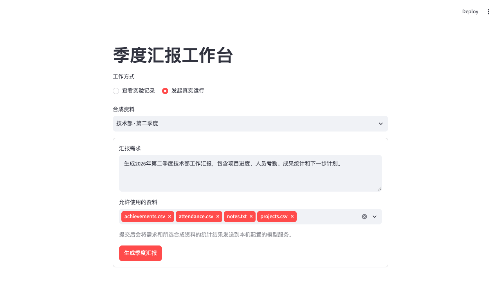
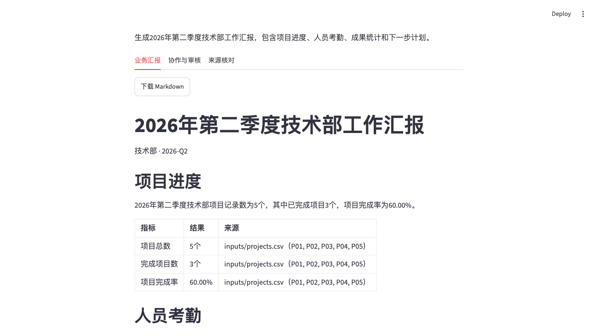
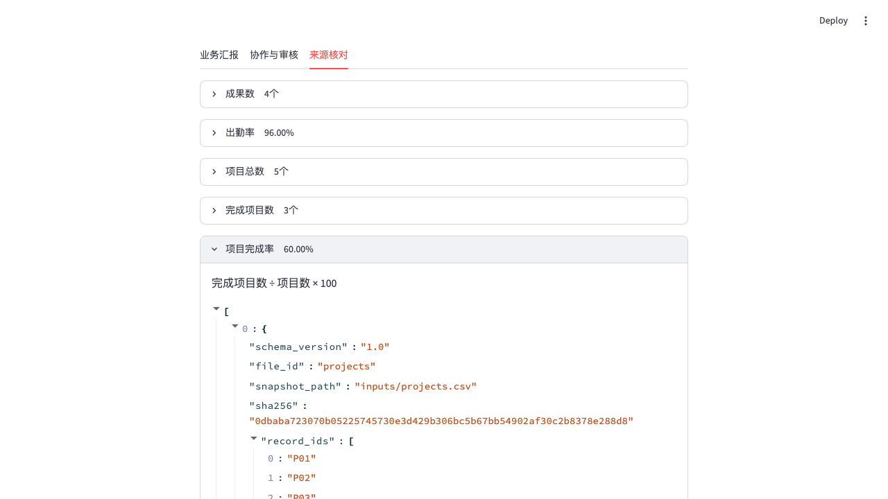
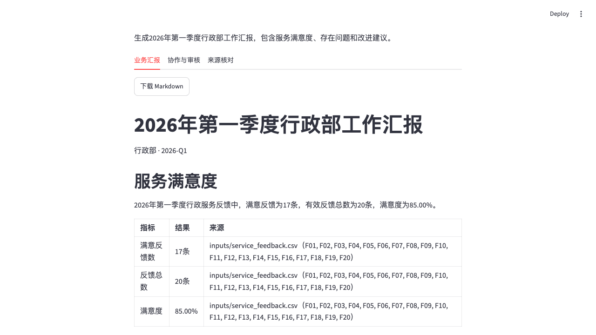
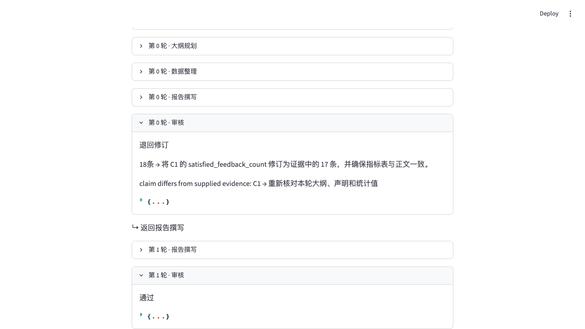
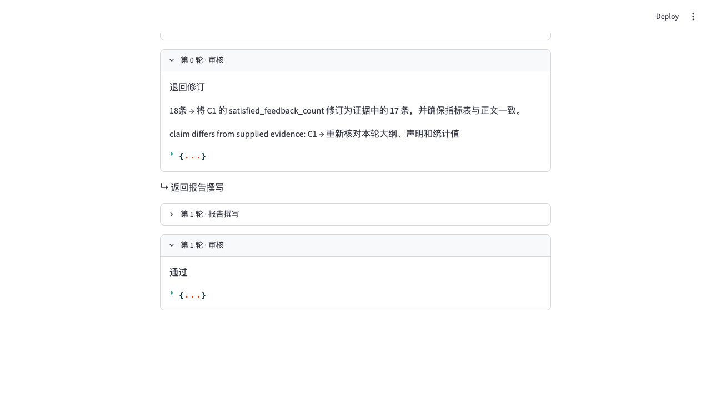

# 课程实验报告

**软件体系结构 · 三人五角色智能办公协作实验 · 2026 年 11 月 24 日**

本实验让五个角色分别处理办公需求、计划、数据、正文和审核。验收对象包括系统生成的业务报告，以及能解释这些报告如何生成的运行记录。技术部和行政部两个正常场景均由真实模型执行，合成资料支持对全部结构化指标进行复算。

## 1 环境与搭建

本次在 macOS 27.3、arm64、Python 3.11.15 环境下验证，使用 LangGraph 1.2.18（MIT）、Streamlit 1.66.1（Apache-2.0）、Pydantic 2.14.1、httpx 0.28.1。角色共用 OpenCode Go 的 deepseek-v4.1-flash。正常运行配置为温度 0、输出上限 4096 tokens、单请求超时 60 秒。环境与模型配置见各运行的 manifest.json，密钥从本机配置读取。API 使用量可以从响应汇总，账单金额未核算。

M1 已在 Python 3.11 虚拟环境中安装固定依赖，验证了文本回复、JSON 输出以及一次真实工具往返。本次在该环境上接入角色、LangGraph、数据工具与 Streamlit，并执行全量测试和浏览器验收。复现时按 README 创建环境、安装固定依赖并启动本机工作台。工作台的“查看实验记录”读取随包附带的证据；“发起真实运行”调用配置的模型。原始 M1 终端截图仍缺，以当时保存的日志核对协议操作。[M1 记录](M1实施记录.md) · [安装与演示](../README.md)

本机复测中，一次经代理的 pip 下载未通过 SHA-256 校验，安装随即停止。改用 uv 从 PyPI 取得相同版本，依赖检查通过。已安装 Python 3.11 和 uv 时，在项目根目录执行以下命令。在线实验需要在本地配置模型密钥。

```bash
python3.11 -m venv .venv
source .venv/bin/activate
uv pip install -r requirements-dev.txt
uv pip install --no-deps -e .
python -m streamlit run app.py --server.address 127.0.0.1
```

## 2 正常场景与复算

| 项目 | 技术部第二季度 | 行政部第一季度 |
| --- | --- | --- |
| 运行编号 | office-0beb5b8a93d5 | office-70c18d122edb |
| 模式、终态 | live，succeeded | live，succeeded |
| 调用、返工 | 6 次调用，0 轮返工 | 6 次调用，0 轮返工 |
| 总耗时 | 73.608 秒 | 89.141 秒 |
| 响应返回的总用量 | 9666 tokens | 12693 tokens |
| 业务产物 | [技术部报告](../evidence/delivery/tech-q2/report.md) | [行政部报告](../evidence/delivery/admin-q1/report.md) |

技术部 P01、P02、P03 已完成，P04、P05 进行中，故完成率为 3 ÷ 5 = 60.00%。考勤三行应到天数为 40、35、25，实到为 38、35、23，故出勤率为 96 ÷ 100 = 96.00%。成果记录 A01 至 A04 共四条，重复编号会被数据工具拒绝。报告分别列出三项业务的指标与记录编号。下一步跨组评审和查询回归可追到 notes.txt 第 4 行。

行政部有 20 条反馈，其中 10 条为 5 分，7 条为 4 分，其余 3 条低于 4 分。按“评分至少为 4”计算满意反馈 17 条，满意度为 85.00%。服务台资料指出访客预约回执偶有延迟，报告将统一回执模板写为建议。技术部的项目文件不参与本次统计。用例额外加入异部门与异季度记录，结果仍为 17/20。

## 3 角色协作与验收

以技术部运行的 events.jsonl 为例，第 6 条事件把 Manager 的任务交给 Planner，第 11 条把大纲交给 Data，第 15、16 条记录实际工具请求与产物，第 20 条将证据交给 Writer，第 25 条将草稿交给 Checker，第 30 条把审核结果交回协调层。每次交接都有本轮产物的相对路径。五个角色实际发生六次模型调用，因为 Data 在选择工具后需要再读取工具返回值。界面下载文件与本地 report.md 已逐字节核对一致。[技术部事件](../evidence/delivery/tech-q2/events.jsonl)

在独立角色实验 office-8767fae41310 中，五个角色分别接收冻结的行政部上游输入。六次真实模型调用完成五项验证。Checker 没有接收程序校验提示，直接对比证据与改动后的草稿，指出 C1 写为 18 条、正确值为 17 条，要求返回 Writer。其余四个角色的输出与日志可按固定输入分别检查。[独立实验](../evidence/delivery/single-roles/summary.json) · [审核原文](../evidence/delivery/single-roles/artifacts/checker-r0.json)

在完整的真实返工实验 office-e89266108729 中，测试钩子先保存原始草稿，再把 C1 从 17 改成 18。程序比对发现数值不一致，模型也写明期望 17 条、实际 18 条。编排只返回 Writer，保留原大纲与证据。第一轮草稿恢复为 17，Checker 经一次输出结构重试后复审通过。全程 109.482 秒、9 次模型请求、1 轮返工。最终审核绑定第一轮草稿的 SHA-256，前缀为 6b82c6fd0ca4。该次单请求上限设为 120 秒。[第零轮审核](../evidence/delivery/revision/artifacts/review-r0.json) · [第一轮审核](../evidence/delivery/revision/artifacts/review-r1.json)

## 4 验证结果与问题记录

| 用例 | 实施方式与结果 |
| --- | --- |
| T01 环境、模型协议 | M1 三项真实探测通过，本次在浏览器启动工作台并生成技术部报告。 |
| T02 单角色 | 五角色独立真实验证全部通过，含 Data 的工具往返与 Checker 对给定错误的定位。 |
| T03、T04 整体协作 | 两个正常场景均实际调用五角色，统计与复算一致。 |
| T05、T06 缺项与非法资料 | 替身工作流检验部门和文件缺项。工具测试覆盖重复 ID、非法数值、编码、零分母、哈希与路径。 |
| T07 审核修订 | live 受控注入，18 修回 17，第一轮复审通过。另有可重复的替身验证。 |
| T08 两轮上限 | 持续注入审核阻断意见，替身运行共 10 次调用，三次审核后停止于 needs_review。 |
| T09、T10 故障与预算 | 认证失败、临时超时、无效 JSON、未知工具、调用与期限上限通过离线验证。另保留真实服务连续超时的失败运行。 |
| T11 界面 | 浏览器真实提交、来源展开、下载、刷新已核对。两个独立 AppTest 会话核对隔离，重复渲染没有重复提交。 |
| T12 组员复现 | 解压源码另建 Python 3.11 环境，uv 安装 67 个固定依赖，依赖检查与 148 项测试均通过。组员独立复现待签认。 |

**Planner 范围扩大。** 早期技术部大纲多出行政满意度章节，Data 因缺少反馈文件终止。修复时只向 Planner 提供本次所需的章节映射，再检查返回的章节清单。之后的技术部真实运行得到预期的四章和最终报告。[早期大纲](../evidence/delivery/debug-planner/artifacts/plan-r0.json)

**Checker 结构错误。** 首次真实注入运行的审核回复两次未通过 JSON 字段校验，系统记录 INVALID_MODEL_OUTPUT 并保留草稿。此前日志没有记录具体违规字段，无法据此反推是哪一个字段。修复增加了审核问题样例，并在下一次修复请求中提供 Pydantic 的字段位置和错误类型。[失败记录](../evidence/delivery/debug-checker/summary.json)

**模型连接超时。** 一次 Manager 调用超时后重试一次，终态 failed，没有最终文件。先核对两种路径对同一模型域名的连通性，再在一次实验进程中直接访问同一服务；机器的代理配置保持原值。该次故障的用量与费用未知。[超时日志](../evidence/delivery/timeout/events.jsonl)

## 5 演示截图

下图来自本地浏览器。源文件与对应的运行编号详见[证据索引](../evidence/index.md)。













## 6 结论与签认

当前交付支持两份正常报告的现场生成与离线回看、结构化来源核验、有限返工与审核后的 Markdown 下载。测试覆盖本地确定性统计和控制流。有限数量的真实运行不足以估计成功率、长期稳定性或平均服务时延，30 分钟连续负载实验未执行。中断的任务保留已有文件，重新提交时创建新运行。原设计与实现细节以[软件体系结构分析](软件体系结构分析.md)为核对入口。

组长与两位组员应在课程提交表分别填写姓名、学号、本人实际承担的工作、可核验的提交或记录，以及本人总结。任务书中的分配是职责安排，个人贡献和同伴评审待实际参与者确认。
