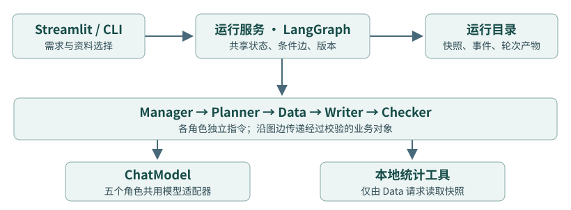
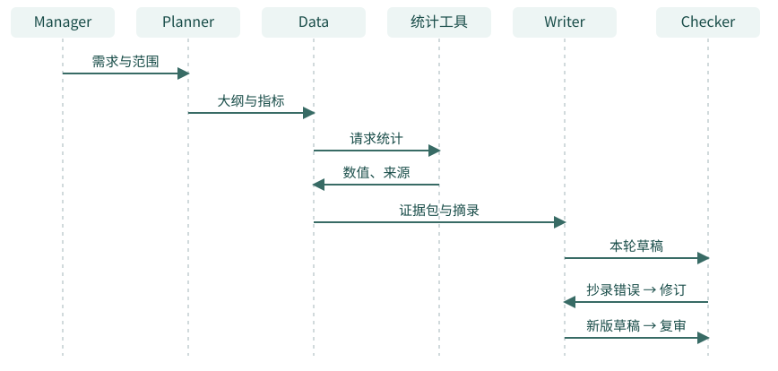

# 软件体系结构分析

**多智能体智能办公汇报系统 · 实现视图**

## 1 由一次审核决定结构

技术部提出季度汇报需求时，“完成率”涉及三个不同的决定。哪些项目属于本季度由资料范围决定，完成率的数值由项目状态和公式决定，这个比例在正文中如何解释由撰写角色决定。如果把三者放在同一次语言模型调用中，读者很难查明错误发生在哪一步。系统为需求、大纲、证据、草稿和审核分别建立带类型的产物，使验收者能指出哪个输入、哪个角色、哪一版文件导致了某个结论。

系统采用分层的单进程应用。表示层接收操作，运行服务确定一次执行的身份、预算和产物位置，编排层决定下一步，角色决定业务内容，工具层负责有固定口径的计算。模型服务通过适配器接入。图中的一条业务边表示已有产物可以交给下一角色；它能携带业务对象，也能在事件中留下可供人检查的文件引用。[运行服务](../src/office_agents/workflow.py) · [角色实现](../src/office_agents/roles.py)

## 2 组件、部署和状态所有权

浏览器通过回环连接访问 Streamlit。一次表单提交才会启动工作流。浏览器展示的事件来自运行服务的回调，单个角色可以更新进度，但无法直接触发文件下载。CLI 和界面共用运行入口，因此一次从命令行开始的行政部实验也能通过工作台回看。回看逐项读取经审阅的本地文件，在课堂没有模型服务连接时仍能讲解实验；新任务需要可用的模型配置和网络。

运行过程中存在三种寿命不同的状态。浏览器会话记住本次界面提交的结果目录；图在内存中保存当前任务的结构化对象；本地文件保存供复核的快照和每轮产物。硬刷新会建立新会话，已写入磁盘的文件仍然存在。工作台默认展示随交付包提供的公开样例，避免在启动时列举机器上其他会话的任务。界面端的进程锁限制同时提交，一条 CLI 命令拥有自己的进程与运行目录。这种安排适合单机课程演示。跨进程排队、用户鉴权和任务恢复需要额外的服务能力。[Streamlit 会话模型](https://docs.streamlit.io/develop/concepts/architecture/session-state)

编排用 LangGraph 的 StateGraph 表达状态、节点和条件边。Manager 产生任务，Planner 产生大纲，Data 产生证据，Writer 产生草稿，Checker 给出审核。角色返回本阶段的对象，运行服务维护轮次、调用次数和事件序号。串行执行使状态在交接点上有一个明确的写入方。下一角色拿到的是校验后的对象，提示词只带它所需的数据。这样的设计可以独立测试一个角色，也便于把错误定位到某一交接边界。[LangGraph Graph API](https://docs.langchain.com/oss/python/langgraph/graph-api)

## 3 一次需求如何流转

Manager 把自然语言变成包含部门、季度、章节名和资料标识的任务。日期写成年份和季度，后续统计使用同一标识。Planner 为章节设定 ID、目的和所需指标。技术部要求项目进度时，项目总数、完成项目数和完成率出现在这一节的计划中。一次早期实验中，模型看到全系统的指标对照表，给技术部加上了行政服务满意度。Data 按大纲寻找资料，因没有反馈文件而停在待补充状态。修复把传入的章节对应表缩小到本次任务，并在接收大纲时核对章节范围。这件事说明接口即便满足类型要求，范围也可能偏离用户意图。

Data 先让模型选择工具。程序检查工具名称和参数，再在本次运行的快照中执行统计。模型收到工具回传后给出覆盖情况说明。证据包中的数值、口径和引用来自同一次程序计算，Writer 的输入直接引用这份证据。工具对百分比使用十进制运算，先汇总后舍入。例如技术部应出勤合计 100 天，实际 96 天，展示值为 96.00%。如果计算每个人的出勤率再取平均，在成员应到天数不同时会改变指标的含义。某一范围内没有记录与存在记录但完成数为零需要产生不同结果。[统计实现](../src/office_agents/statistics.py)

Writer 给出原名对应的章节、正文和所需呈现的指标 ID。程序据此构造结构化声明，并在导出时生成指标表。文字摘录保留快照文件和行号。用相同资料重新生成，表格应当可以逐项复算，正文可能更换遣词。Checker 同时看到大纲、证据和草稿，对措辞、事实与材料的关系进行语义判断。结构化声明还须通过确定性规则，例如每个声明属于哪个章节、数值和单位是否与证据相同、每章必需指标是否齐全。两类检查承担不同的错误成本：数值检查能够重复执行，关于原因、建议和成效的判断仍有人工复核价值。

## 4 返工、失败以及可审计的交付

草稿第一次保存于第零轮。审核记录绑定该草稿的文件路径、SHA-256 和证据引用。审核通过时，运行服务重新读取已保存草稿并检查指纹，再写临时文件并替换为最终报告。下载按钮读取已经保存的文件。这样可以把读者下载的成果与审核对象联系起来，也可避免点击下载时重新生成另一种措辞。指纹能说明内容是否一致；要抵御有权限同时改写报告、日志和指纹的人，还需要独立保存和签名机制。

若审核发现抄错指标，条件边返回 Writer，只重做草稿和审核。若依据不完整，返回 Data 并重跑后面的写作和审核；大纲问题回到 Planner。下一轮通过独立文件名保留原来的产物。控制器依据问题类别确定目标，多类问题先修影响下游最广的一项。初稿后最多返工两次，仍有阻断意见就转人工复核。若模型服务暂时不可用，单次调用允许有限重试；认证错误直接停止。十分钟期限和三十次模型调用上限约束一次任务的消耗。局部错误可以定位到事件序号，服务故障和资料缺失可以分别统计。

每份输出的来源有两层。第一层是业务来源，包括哪条记录属于本期、公式如何使用这些记录、摘录取自哪一行。第二层是运行来源，包括使用哪个模型、哪份大纲、哪轮草稿和审核。行政部样例在第一层有二十条反馈，十七条评分至少为四分；在第二层可以找到产生指标的工具事件及其后续交接。两层合起来足够让同学重新核算表格并解释系统如何得出草稿。若课程要求个人贡献或同伴验收，仍需相应成员提供本人记录。

## 5 传统多智能体系统的对照

FIPA ACL 定义通信行为及消息结构，可以描述发送者、接收者、交互意图和内容。它关注不同 Agent 如何理解一次交流；具体系统可以采用多种决策和部署方式。本项目的角色也有发送方、接收方和交接对象，但交接语义由一套课程业务协议和固定状态图定义。在“审核退回”这个例子里，可执行含义来自问题类别到角色的映射，事件中的自然语言建议供下一角色阅读。更换为另一套业务时，该映射与字段约束也需要一起调整。[FIPA ACL Message Structure Specification，§2](https://ppgia.pucpr.br/~fabricio/ftp/Aulas/Mestrado/AS/Aula3/SC00061G_FIPA_ACL.pdf)

采用语言模型后，输入可以从一句中文扩展成大纲、说明或修改意见，节省为每种表述编写解析器的工作。代价是合乎 JSON 格式的内容仍可能超出资料范围，两次运行的措辞和时延也会变化。这里用固定条件边约束任务调度，用工具隔离可复算的动作，用语义审核处理难以写成公式的内容。传统消息协议可以与学习、规划或语言模型结合，选择的关键在于参与者是否需要独立部署、异步协商以及跨系统互通。固定顺序的课堂汇报更看重一条可解释、可演示的因果链。

## 6 质量属性与演进成本

增加一个新的业务指标，例如平均响应时长，需要明确数据字段、时间单位、缺失值和分母口径，然后修改指标枚举、确定性计算、章节映射、展示名称和复算用例。如果仅改提示词，模型可能在没有来源的情况下生成可读的陈述。更换兼容的模型服务对组件影响较小，但仍需重新验证 JSON 结构、原生工具往返和语义审核，已有服务的成功运行不能证明新提供方的行为。串行设计便于定位错误，也使总时延累积。在考虑并行读取前，应先从各次调用记录判断耗时是否主要发生在网络和模型生成阶段。

本地工具限制文件名、大小、编码和路径，按快照哈希验证读入内容；模型不能指定任意系统命令或路径。用于展示的文本依然只是资料，恶意或错误的文字可能影响模型的语言判断。演示包只包含人工编制的业务数据；上线处理真实组织资料时，还要解决权限划分、外部模型的数据传输约束、保留期限以及审计数据访问。当前的单机进程和文件证据优先服务于复现和教学。若工作负载演变为多人同时提交长任务，才有足够理由引入队列、任务数据库和可恢复检查点，并重新验证重试时文件导出与模型计费的幂等性。
